<div align="center">


# 企智搭 · 代码平台

**QiZhiDa Code Platform (QIZHIDA)** — 面向企业研发团队的 AI 编程与工程协作平台

在你的代码工作区里干活 —— 读代码、改代码、跑命令、给结果。
每一步动手都**留痕可查**，高风险的还要**人批过**。

---

[](#-快速开始)
[](#-功能模块)
[](#-功能模块)
[](#-已知边界)
[](#-已知边界)

[项目介绍](#-项目介绍) · [产品价值](#-产品价值) · [重点能力](#-重点能力讲解) · [快速开始](#-快速开始) · [控制台一览](#-控制台一览) · [功能模块](#-功能模块) · [技术架构](#-技术架构) · [部署](#-部署) · [文档索引](#-文档索引)

</div>

---

##  项目介绍

**企智搭 · 代码平台 (QIZHIDA Code Platform)** 是一套面向企业研发团队的 AI 编程与工程协作平台。

它不是一个"问答机器人"，而是**一个能在你的代码库里真的动手、并对每次动手负责的 agent**：

- **真的动手** —— 读文件、精确编辑、新建/删除文件、跑 shell、跑 Python、开分支、提 commit、合并分支
- **真的验证** —— 跑测试、跑构建，用**真实执行结果**判断改动能不能用，而不是"看起来对"
- **真的受管** —— 改代码自动放行，跑命令、联网要人批，破坏性操作永远要人批；每一次调用都留痕可查
- **真的沉淀** —— 失败会变成复盘，改进落进**记忆 / 技能 / 提示词**三层，下一轮 agent 就带着它干活

| 我们不是 | 我们是 |
| --- | --- |
|  一个聊天机器人 |  一个**在代码工作区里动手的 agent** |
|  一个只会写代码片段的助手 |  一个**能跑命令、能验证、能提交分支**的工程协作者 |
|  一个工具随便调的 agent 框架 |  一个**能力调用都过同一条流水线**的平台：声明 → 校验 → 风险 → 审批 → 留痕 |
|  一个跑在聊天框里的 demo |  一个**自带沙箱隔离、白名单与 Docker 部署**的工程系统 |

后端 **Python 3.11+ · FastAPI · SQLAlchemy 2.x (async) · deepAgents 0.7 / LangChain 1.4 / LangGraph 1.2**，
前端 **React 19 · Vite 8 · TypeScript · Tailwind v4**。

---

##  产品价值

| 支柱 | 价值 | 落地方式 |
| --- | --- | --- |
|  **动手可审计** | agent 改了什么、跑过什么、谁批的，全查得到 | 统一能力清单 → 意图 → **七阶段流水线** → 留痕 · 风险分档（读/写低 · 执行/联网中 · 破坏性高）· **两级审批**（声明级 + 参数级） |
|  **在真环境里干活** | 不是"看起来对"，是**跑过了** | docker 沙箱：`--network none` · `--cap-drop ALL` · `no-new-privileges` · 限内存限 CPU 限进程 · **容器按会话复用**（装好的依赖跨轮次保留） |
|  **能力可组合** | 工具、技能、MCP 在一张清单里，不认别的来源 | **统一能力清单**（17 条出厂能力）· 技能带工具与用法 · MCP 服务器接入 · **子 agent 派活**（独立 worktree，递归封顶两层） |
|  **失败会变经验** | 干砸了不是白干 | 失败 → **复盘** → 改进落进 **记忆 / 技能 / 提示词**三层 · 三层都能**撤销** · 同类失败**复发率**可度量 |

### 价值流转

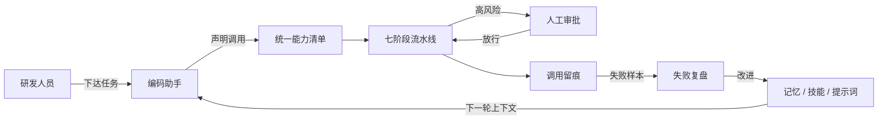

---

##  重点能力讲解

### 1.  编码助手

唯一的对话入口，也是平台的主界面。

- **流式 SSE 对话** —— 回复逐字吐出来，工具调用折叠成 `Ran npm install…` 那种块
- **工具调用实时可见** —— 读文件、跑命令、查记忆、检索知识库，每一步都有状态图标
- **审批卡直接弹在对话里** —— 不用切页面，批准 / 拒绝就在那条消息下面
- **五种权限模式**（会话级，语义与 Claude Code 对齐）：`auto`（按风险档位）· `manual` · `accept_edits` · `plan`（写类工具**不暴露给模型**）· `bypass`（受进程级总闸约束）
- **分支与重新生成** —— 从某条消息分支出新会话；重新生成会重跑副作用（**当前没有**"这轮已产生副作用"的检查）

### 2.  能力与治理

平台的核心主张：**平台声明的能力，全部走同一条流水线**（文件与命令那一族是例外，见「已知边界」）。

```text
统一能力清单 → 意图 → 七阶段执行 → 留痕 → 人工审批
```

七阶段：**schema 校验 → 权限校验 → 幂等去重 → 风险判定 → 执行（带重试与熔断）→ 结果校验 → 留痕**。

两级审批：

| 级 | 看什么 | 挂起点 |
| --- | --- | --- |
| 声明级 | 工具本身（"execute 这个工具要人批"） | 工具执行**之前** |
| 参数级 | 这次调用的参数（"这条命令里有 `rm -rf`"） | 工具执行**中** |

风险分档：`read` / `write` → **低**（自动放行）· `execute` / `network` → **中**（要人批）· `destructive` → **高**（永远要人批）。参数级规则**只能上调风险，不能下调**。

### 3.  沙箱与工作区

agent 跑命令的地方是**兄弟容器**，不是宿主进程。

- 隔离参数：`--network none` · `--memory 512m` · `--cpus 1` · `--pids-limit 256` · `--cap-drop ALL` · `--security-opt no-new-privileges`
- **容器按会话复用**（`docker exec`，不是每次 `docker run --rm`）—— 装好的包、生成的文件跨轮次保留
- **工作区**就是真实的代码仓库：白名单根目录下的普通目录，或某个 git 仓库派生的独立检出（worktree）
- 子 agent 在**自己的 worktree + 自己的分支**里干活，不跟主 agent 打架

### 4.  记忆与知识库

**记忆只有两层**，不多不少：

| 层 | 范围 | 落在哪 |
| --- | --- | --- |
| 短期 | 一个会话内 | `memory_item` 表 |
| 长期 | 跨会话 | RAG 专用集合 `agent-memory` |

写入有**硬校验**：凭据拦截、冲突拒绝、取代语义。召回是**混合检索**（向量 + BM25 关键词），不是纯向量。

知识库（RAG）独立成层：集合 / 文档 / 分块三级，混合召回，每个召回片段带原文出处。

> `AGENTS.md` **不是记忆** —— 它是工作区级、agent 自己维护的说明文件，每轮全量注入。

### 5.  自我进化

失败不是白干。一轮结束、这一轮有失败时，平台在后台跑一次复盘：

- 复盘问模型三件事：**错在哪**（根因，不是"命令失败了"）、**下次怎么改**（一条具体做法）、**改在哪一层**
- 改进落进**记忆 / 技能 / 提示词**三层之一 —— 三层**都能撤销**
- **免审批的代价是三道闸**：范围守卫（自生成的规则不得触碰审批 / 权限 / 沙箱那一层）· 全程留痕 · 事后可撤销
- 度量：复盘次数、被谁拦下、**同类失败复发率** —— 改进有没有用，看复发率降没降

---

##  快速开始

### Docker 一键起（推荐）

```bash
# 1. 准备环境变量（仓库根目录）
cp .env.docker.example .env
#    填两样必填的：
#      WORKSPACE_ROOT —— 工作区根目录（绝对路径，见下）
#      API_KEY_ENCRYPTION_KEY —— cd backend && ../.venv/bin/python scripts/gen_encryption_key.py

# 2. 起
docker compose up -d --build

# 3. 开
open http://localhost:8080
```

控制台在 <http://localhost:8080>，接口文档在 <http://localhost:8080/docs>。

**验一下部署**：

```bash
cd backend && ../.venv/bin/python scripts/deploy_smoke.py \
    --base-url http://localhost:8080 --workspace-root /你的/工作区路径
```

### 本地开发

```bash
# 后端（**必须在 backend/ 目录启动** —— .env 在那儿）
python3 -m venv .venv
.venv/bin/pip install -r backend/requirements.txt
cd backend && ../.venv/bin/uvicorn app.main:app --reload   # :8000

# 前端
cd frontend && npm install && npm run dev                   # :6001
```

前端通过 Vite 代理把 `/api` 转发到后端，**不用配 CORS**，生产同域部署时前端代码一行都不用改。

### 验收清单

```bash
cd backend && ../.venv/bin/python scripts/deploy_smoke.py \
    --base-url http://localhost:8080 --workspace-root /你的/工作区路径
```

| 步骤 | 期望结果 | 状态 |
| --- | --- | --- |
| ① 健康检查 | `GET /api/v1/health` 返回 `{"status":"ok"}` |  |
| ② 前端首页 | 控制台能打开，侧栏分区可折叠 |  |
| ③ 能力清单 | 17 条出厂能力（16 工具 + 1 技能）列得出 |  |
| ④ 调一次能力 | `run_python` 落审批 → 批准 → 在沙箱容器里真跑起来 |  |
| ⑤ 工作区共享 | 沙箱写出的文件在宿主工作区里看得见 |  |

---

##  控制台一览

> 截图来自**本地 Docker 部署的真实实例**（<http://localhost:8080>），不是前端 mock。

| | |
| --- | --- |
| 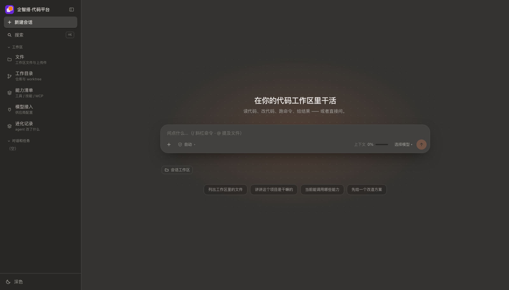 | 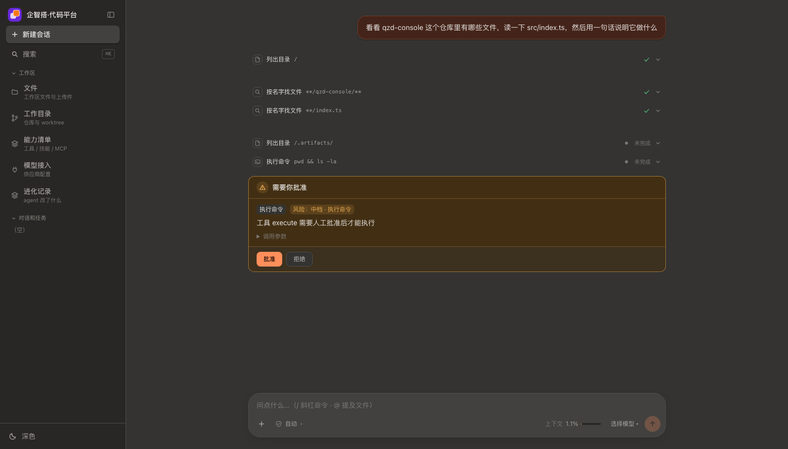 |
| **编码助手** — 流式回复 · 工具调用折叠成块 · 上下文用量 | **人工审批** — 风险分档写在卡片上，批准 / 拒绝就在消息下面 |
| 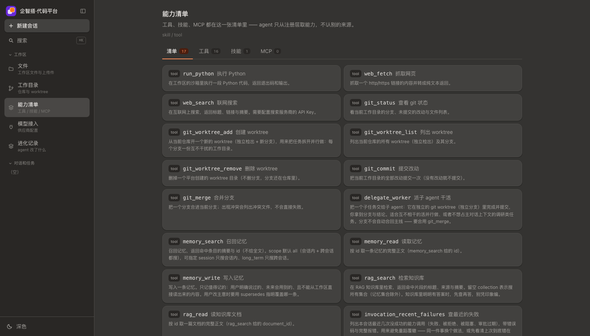 | 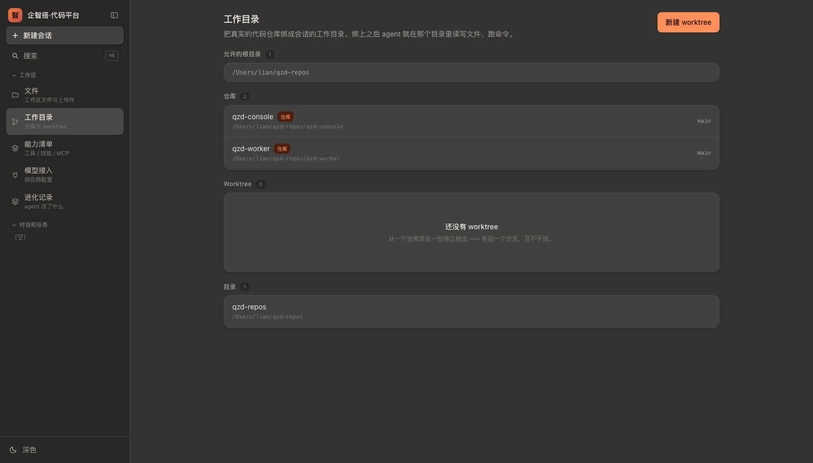 |
| **能力清单** — 工具 / 技能 / MCP 统一成一张清单 | **工作目录** — 白名单里的仓库与 worktree |
| 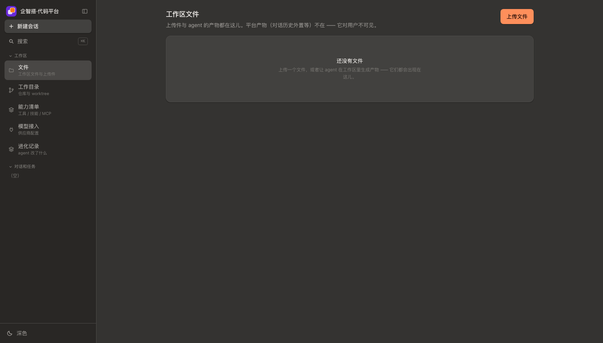 | 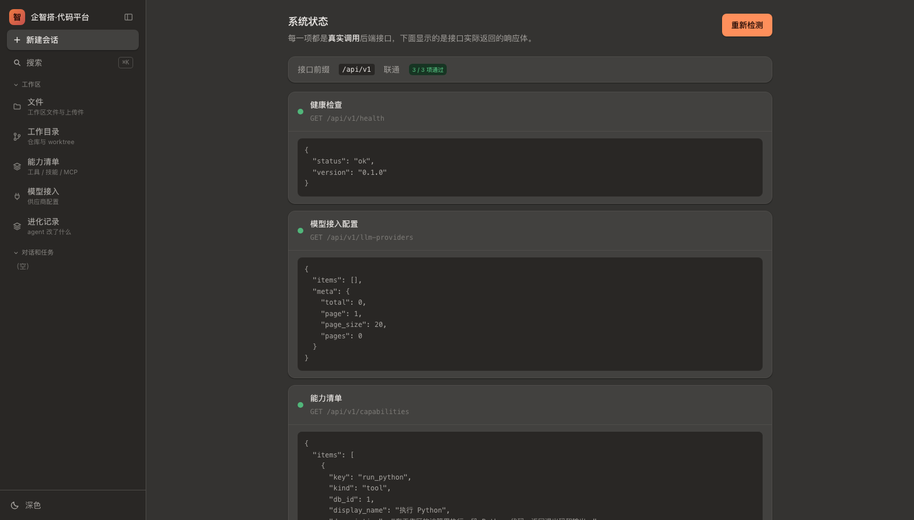 |
| **文件** — 工作区文件与上传件 | **系统状态** — 每一项都是**真实调用**后端接口，下面是接口实际返回的响应体 |
| 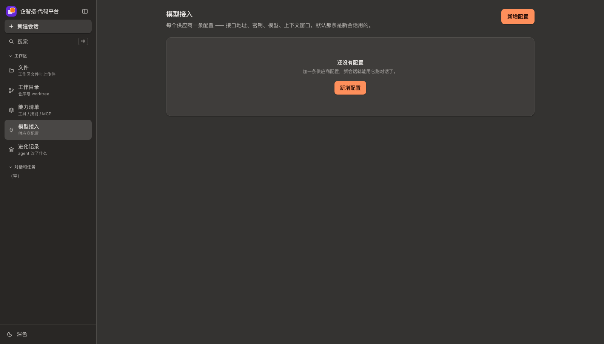 | 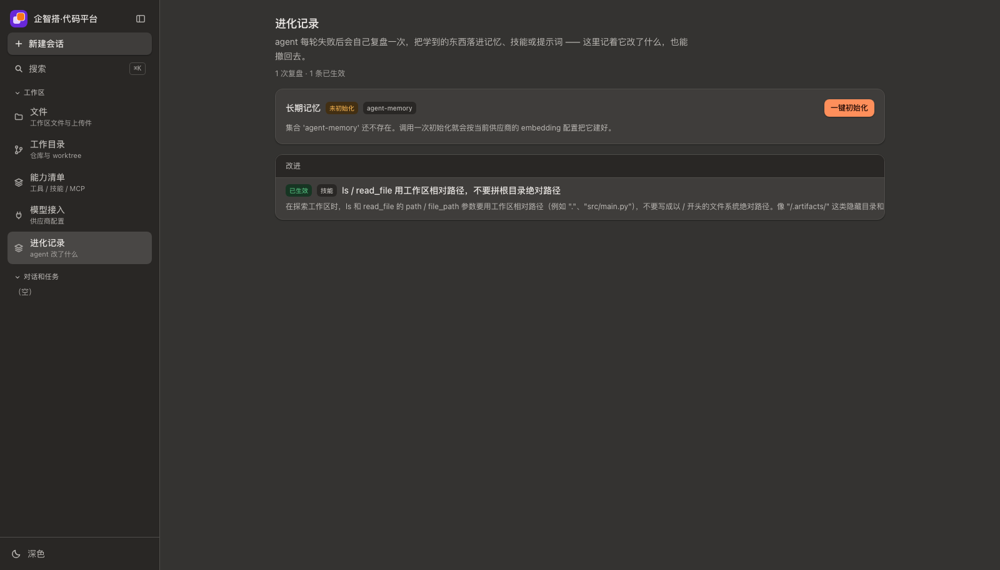 |
| **模型接入** — 供应商配置（密钥加密落库） | **进化记录** — 复盘做了什么改进、能不能撤销、复发率降没降 |

---

##  功能模块

平台按 **4 层 + 1 个横切关注点** 组织：

- **入口层** — 编码助手（对话）+ 工作区（文件 / 目录 / 能力 / 模型 / 进化记录）
- **能力层** — 10 个功能模块，每篇文档讲清它是什么、接口有哪些、怎么实现的、**哪些地方改错了会出事**
- **基础设施层** — 存储（SQLite / Postgres）· 沙箱（docker）· LLM 供应商 · 文件
- **横切关注点** — **能力流水线与治理**，贯穿每一层每一条调用

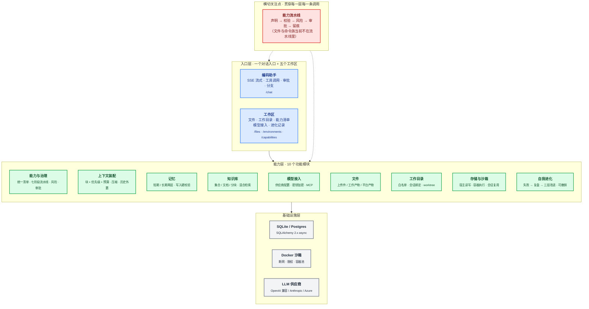

### 10 个模块总表

| # | 模块 | 职责 | 文档 |
| --- | --- | --- | --- |
| 1 | 编码助手 | 唯一的对话入口：消息流、审批挂起与恢复、权限模式、分支与重新生成、子代理派活 | [modules/agent-chat.md](docs/modules/agent-chat.md) |
| 2 | 能力与治理 | 所有工具调用的唯一通路：能力清单 → 意图 → 七阶段流水线 → 留痕；风险判定与人工审批 | [modules/capability.md](docs/modules/capability.md) |
| 3 | 记忆 | 短期落表 / 长期落 RAG 两层；三层渐进式召回；写入判据与硬校验 | [modules/memory.md](docs/modules/memory.md) |
| 4 | 知识库 | RAG 服务层：集合 / 文档 / 分块、混合检索；也作为只读能力暴露给 agent | [modules/knowledge.md](docs/modules/knowledge.md) |
| 5 | 上下文装配 | 块 + 优先级 + 预算 → 系统提示词；每轮动态注入；压缩与历史外置 | [modules/context.md](docs/modules/context.md) |
| 6 | 文件 | 上传件 / 工作产物 / 平台产物三类文件；对话里的多模态输入 | [modules/files.md](docs/modules/files.md) |
| 7 | 工作目录 | 白名单、会话绑定、git worktree；子 agent 的独立检出 | [modules/workspace.md](docs/modules/workspace.md) |
| 8 | 模型接入 | 供应商配置与密钥加密；MCP 服务器接入 | [modules/providers.md](docs/modules/providers.md) |
| 9 | 存储与沙箱 | 文件操作在宿主、命令执行在容器；容器按会话复用 | [modules/storage-sandbox.md](docs/modules/storage-sandbox.md) |
| 10 | 自我进化 | 失败 → 复盘 → 改进落进记忆 / 技能 / 提示词；三层都可撤销 | [modules/evolution.md](docs/modules/evolution.md) |

---

##  技术架构

### 设计原则

1. **一条通路** —— 所有能力调用走同一条流水线，不给"后门"
2. **声明优先** —— agent 只从**注册表**取能力，不认别的来源；每条声明带 schema、风险、权限、超时、重试、幂等
3. **风险只上调** —— 参数级规则能加严，不能放宽
4. **审批位置固定** —— 审批闸挂在哪些工具上**不随权限模式变**，模式只决定拦不拦（否则挂起期间切模式就丢恢复值）
5. **沙箱只提供执行** —— 文件操作走宿主后端（快、路径天然虚拟），命令执行进容器（隔离）
6. **失败要变成经验** —— 改进落进记忆 / 技能 / 提示词，三层都可撤销

### 部署拓扑

```mermaid
graph TB
    subgraph Entry [" 入口层"]
        direction LR
        Browser["浏览器"] --> Nginx["nginx :80<br/>静态资源 + /api 反代<br/>SSE 关缓冲"]
    end

    subgraph App [" 应用层"]
        App["FastAPI :8000<br/>10 个功能模块<br/>deepAgents 0.7 / LangGraph 1.2"]
    end

    subgraph Data [" 数据层"]
        direction TB
        DB[("SQLite / Postgres<br/>app.db · agent_checkpoints.db<br/>alembic 迁移")]
    end

    subgraph Sandbox [" 沙箱层 · 兄弟容器"]
        direction TB
        SB["docker 容器（按会话复用）<br/>--network none · --cap-drop ALL<br/>no-new-privileges · 限内存限 CPU<br/>只挂载会话工作区"]
    end

    subgraph Model [" 模型层"]
        LLM["LLM 供应商<br/>OpenAI 兼容 / Anthropic / Azure<br/>密钥 Fernet 加密落库"]
    end

    Browser --> Nginx
    Nginx --> App
    App --> DB
    App --> SB
    App --> LLM
```

### 一次工具调用（时序）

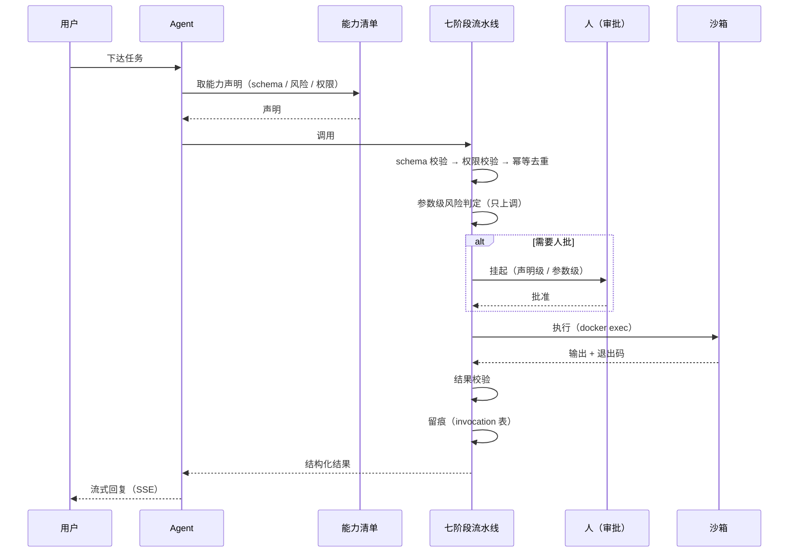

### 技术栈

| 层 | 选型 |
| --- | --- |
| 前端 | React 19 · Vite 8 · TypeScript · Tailwind v4 · react-router 8 |
| 后端 | Python 3.11+ · FastAPI · SQLAlchemy 2.x (async) · Pydantic v2 |
| Agent | deepAgents 0.7 · LangChain 1.4 · LangGraph 1.2（checkpointer / store / HITL） |
| 数据 | SQLite（aiosqlite）· 可换 Postgres（asyncpg）· Alembic 迁移 |
| 检索 | 自研分块（text / markdown / code 三种策略）· 向量 + BM25 混合召回 |
| 沙箱 | docker（兄弟容器）· `--network none` · `--cap-drop ALL` · 会话复用 |
| 部署 | docker compose（nginx + FastAPI）· 冒烟脚本自检 |

### 仓库结构

```text
.
├── backend/                      FastAPI 后端
│   ├── app/
│   │   ├── agents/               agent 运行时（runner / builder / 复盘 / 反思）
│   │   ├── capabilities/         能力层：注册 · 意图 · 执行流水线 · 治理中间件
│   │   ├── backends/             后端组装：宿主文件后端 · docker 沙箱 · 容器池
│   │   ├── context/              上下文装配：块 · 优先级 · 预算 · 压缩
│   │   ├── memory/  rag/         两层记忆 · RAG 服务层
│   │   ├── services/  api/       业务服务 · HTTP 接口
│   │   └── db/  models/          会话 · 数据模型
│   ├── alembic/                  迁移链
│   ├── tests/                    547 项回归测试
│   ├── scripts/                  冒烟脚本 · 密钥生成
│   └── Dockerfile                后端镜像
├── frontend/                     React 控制台
│   ├── src/features/             按功能模块分目录
│   ├── src/pages/                页面
│   └── Dockerfile                前端镜像（构建 → nginx 托管）
├── docs/                         按功能模块组织的文档 + 部署说明
│   ├── modules/                  10 篇模块文档
│   ├── deployment.md             Docker 部署
│   ├── writing-conventions.md    写作约定 + 框架的红线 + 跨模块共享事实
│   └── images/                   品牌资产与截图
├── docker-compose.yml            两个容器：nginx + FastAPI
└── README.md
```

---

##  部署

### 环境

| 工具 | 版本 | 说明 |
| --- | --- | --- |
| Python | 3.11+ | 后端运行时 |
| Node.js | 20+ | 前端运行时（镜像用 24） |
| Docker | 24+ | 沙箱容器 + 整套部署 |

### 端口

| 端口 | 服务 | 启动命令 |
| --- | --- | --- |
| `:8000` | FastAPI（本地开发） | `cd backend && ../.venv/bin/uvicorn app.main:app --reload` |
| `:6001` | Vite（本地开发） | `cd frontend && npm run dev` |
| `:8080` | nginx（Docker 部署的统一入口） | `docker compose up -d --build` |

### Docker 部署的三个硬约束

1. **工作区路径宿主与容器必须一致** —— 沙箱容器的挂载参数按**宿主路径**解释，两边字面不同会挂进空目录，而 **docker 不报错**（agent 只看到"文件不存在"）
2. **后端要挂 docker socket** —— 沙箱是**兄弟容器**不是嵌套容器；代价是等于把宿主机 root 给了容器
3. **工作目录白名单里的仓库也要挂进去** —— 没挂进来的目录平台看不见，白名单就是空的

细节、备份、升级、常见问题见 **[docs/deployment.md](docs/deployment.md)**。

---

##  已知边界

写在前面：**平台目前没有鉴权。** 所有接口都是裸的 —— 知道 `thread_id` 就能读写别人的会话、文件与记忆。上线前必须补。

<details>
<summary><b>Q: 哪些接口是裸的？最重的是哪条？</b></summary>

模型接入配置、能力调用、审批、记忆、文件。**最重的是文件接口** —— 知道 `thread_id` 就能下载别人会话里的所有文件。

</details>

<details>
<summary><b>Q: 文件与命令类工具也走七阶段流水线吗？</b></summary>

**不走。** `ls` / `read_file` / `write_file` / `edit_file` / `delete` / `glob` / `grep` / `execute` 这八个由 deepAgents 的文件系统中间件提供，只落一份**简化**的调用记录 —— 没有 schema 校验、权限校验、幂等去重、熔断、结果验证。

它们**仍然**过参数级风险判定（`rm -rf`、SSRF 能被拦下），但那句"每次调用都过同一条流水线"目前对这一族**不成立** —— 而这恰恰是风险最高的一族。

</details>

<details>
<summary><b>Q: 容器怎么复用？什么不保留？</b></summary>

容器**常驻**、按会话标识命名，用 `docker exec` 而不是每次 `docker run --rm`。

- **保留**：装好的包（pip / npm install）、容器里生成的文件、跑起来的后台进程
- **不保留**：环境变量、当前目录 —— 那是 `docker exec` 的固有语义（每次 exec 都是新进程）

</details>

<details>
<summary><b>Q: 派子 agent 会阻塞主 agent 吗？</b></summary>

会。`delegate_worker` 是同步的 —— worker 跑完，这一轮的工具调用才返回。worker 在**自己的 worktree + 自己的分支**里干活，容器只挂那个 worktree，**递归封顶两层**。

</details>

<details>
<summary><b>Q: 改了代码怎么验？</b></summary>

```bash
cd backend && ../.venv/bin/python -m pytest -q   # 547 项回归测试
cd frontend && npm run lint && npm test && npm run build
```

</details>

---

##  文档索引

| 文档 | 路径 | 用途 |
| --- | --- | --- |
| **功能模块索引** | [docs/README.md](docs/README.md) | 十篇模块文档的入口 |
| **编码助手** | [docs/modules/agent-chat.md](docs/modules/agent-chat.md) | 对话、审批挂起与恢复、权限模式、分支 |
| **能力与治理** | [docs/modules/capability.md](docs/modules/capability.md) | 统一清单 · 七阶段流水线 · 风险 · 审批 |
| **记忆 / 知识库** | [docs/modules/memory.md](docs/modules/memory.md) · [docs/modules/knowledge.md](docs/modules/knowledge.md) | 两层记忆 · RAG 服务层 |
| **上下文装配** | [docs/modules/context.md](docs/modules/context.md) | 块 · 优先级 · 预算 · 压缩 |
| **存储与沙箱** | [docs/modules/storage-sandbox.md](docs/modules/storage-sandbox.md) | 宿主读写 · 容器执行 · 会话复用 |
| **自我进化** | [docs/modules/evolution.md](docs/modules/evolution.md) | 失败 → 复盘 → 三层改进 · 可撤销 |
| **部署说明** | [docs/deployment.md](docs/deployment.md) | Docker 部署 · 工作区路径约束 · 常见问题 |
| **写作约定** | [docs/writing-conventions.md](docs/writing-conventions.md) | 文档语气与结构 · **框架的红线** · 跨模块共享事实 |
| **后端 / 前端** | [backend/README.md](backend/README.md) · [frontend/README.md](frontend/README.md) | 分层 · 目录 · 配置 · 迁移 · 风险 |

---

##  许可证

本项目基于 **Apache License 2.0** 开源。

```
Copyright 2026 QIZHIDA Contributors

Licensed under the Apache License, Version 2.0 (the "License");
you may not use this file except in compliance with the License.
You may obtain a copy of the License at

    http://www.apache.org/licenses/LICENSE-2.0
```

---

<div align="center">

**[ 回到顶部](#企智搭--代码平台)**

Made with  by the QIZHIDA team

</div>
